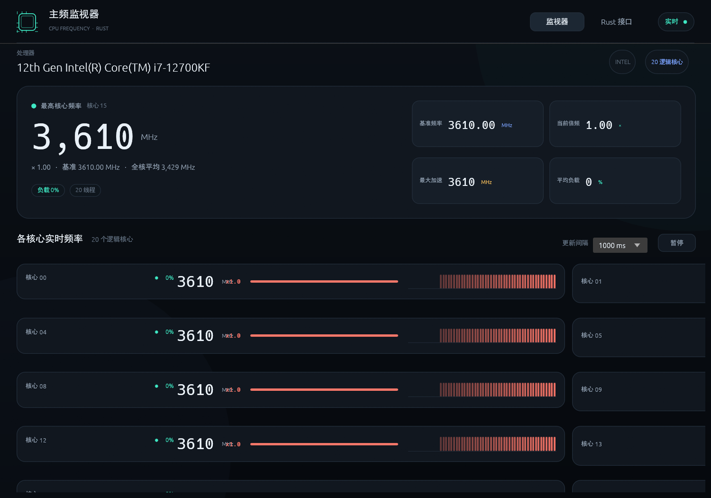

# CoreTempCraft — see what each core is doing, right now

<p align="center">
  
</p>
<p align="center"><sub>CoreTempCraft on an Intel i7-12700KF: 20 logical cores, each at its current frequency</sub></p>

[](LICENSE)
[](#build-and-run)
[](https://github.com/storytold/craft-anything)

**English (default)** · [简体中文](README.zh-CN.md)

> **A CPU's real speed is never just the number on the box.**
> CoreTempCraft shows the current multiplier, the bus clock it was measured at, the resulting
> frequency for every logical core, and the package temperature — no kernel driver, no admin rights.

- ⚡ **Per-core frequency** — multiplier × measured bus clock, refreshed on a fixed interval
- 🌡 **Package temperature** — from the thermal zone Windows reports, with an honest "estimated" mark when there is none
- 🧮 **Measured base clock** — when Windows doesn't report one, it measures it from the CPU timestamp counter over five seconds
- 📈 **History** — a sparkline per core and the latest sample as a list
- 🪶 **Small and local** — Rust + egui, one window, no account, no network

## Build and run

Requires Rust (edition 2021) and, on Windows, the MSVC toolchain.

```sh
cargo run --release
```

## Status

It builds, starts and draws, and the checks made while rebuilding it pass. It is a study
reimplementation: it reproduces behaviour, not code, assets or branding.

## Credits

Built with [Craft Anything](https://github.com/storytold/craft-anything), the clean-room engine that
shows how software works and then builds your own version of it.

A community app of the [ArtCraft](https://getartcraft.com/) family — [www.mengbot.com.cn](https://www.mengbot.com.cn).

This is an independent project. It is not affiliated with, endorsed by, or connected to the authors
of any commercial program it was studied from.

## License

MIT — see [LICENSE](LICENSE).
