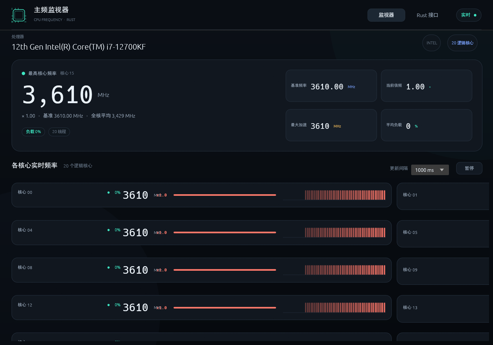

# CoreTempCraft — 实时看清每个核心在做什么

<p align="center">
  
</p>
<p align="center"><sub>CoreTempCraft 在 Intel i7-12700KF 上运行：20 个逻辑核心，各自显示当前频率</sub></p>

[](LICENSE)
[](#构建与运行)
[](https://github.com/storytold/craft-anything)

[English (default)](README.md) · **简体中文**

> **CPU 的真实速度，从来不只是包装盒上的数字。**
> CoreTempCraft 显示当前倍频、实测总线频率、每个逻辑核心的实时频率，以及封装温度——不需要内核驱动，也不需要管理员权限。

- ⚡ **逐核频率** —— 倍频 × 实测总线频率，按固定间隔刷新
- 🌡 **封装温度** —— 来自 Windows 上报的热区；取不到时如实标注"估算"
- 🧮 **实测基频** —— 系统不给基频时，用 CPU 时间戳计数器在 5 秒窗口内实测
- 📈 **历史曲线** —— 每个核心一条迷你曲线，外加最新一次采样列表
- 🪶 **小且本地** —— Rust + egui，单窗口，无账号、无联网

## 构建与运行

需要 Rust（2021 edition），Windows 上需要 MSVC 工具链。

```sh
cargo run --release
```

## 状态

可编译、可启动、可绘制，复刻过程中的检查项均通过。这是一个学习性的重新实现：复刻的是行为，不包含原程序的代码、素材或品牌。

## 致谢

使用 [Craft Anything](https://github.com/storytold/craft-anything) 构建——看清软件如何工作，然后做出你自己的版本。

[ArtCraft](https://getartcraft.com/) 家族社区应用 —— [www.mengbot.com.cn](https://www.mengbot.com.cn)。

本项目为独立项目，与原程序的作者无隶属、 endorsement 或关联关系。

## 许可证

MIT —— 见 [LICENSE](LICENSE)。
